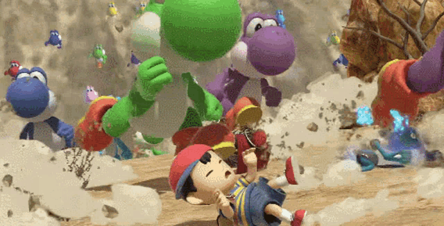

# Bienvenidos a mi perfil de GitHub 

*Although my heart may be weak, it's not alone*\
*It's grown with each new experience,*\
*and it's found a home with all the friends I've made.*\
*I've become a part of their heart just as they've become a part of mine.*\
*And if they think of me now and then...*\
*if they don't forget me... **then our hearts will be one**.*\
*I don't need a weapon. **My friends are my power!***

| Escucha mis músicas favoritas  |
| - |

# Sobre mí 

Universitario. Actualmente me encuentro estudiando programación. Apasionado por los videojuegos.
Los pollos son mis animales favoritos. Camino a ser el mejor Yoshi.

- **Nombre:** Ema
- **Edad:** 19 años
- **Género:** Masculino
- **Carrera:** Ciencia de datos e inteligencia artificial
- **Gustos:** Videojuegos, Anime, Programación, Dibujo, Caminar, Pollos 🐓
- **Disgustos:** Leer, Levantarme temprano, Quedarme mucho tiempo sin hacer nada
- **Facción:** *Bony Spirit hasta la muerte⌚👻*

# Áreas de interés 🎮🥊

El apartado en el que más me siento interesado es en la programación de Videojuegos, si bien todavía me encuentro muy lejos
de programar un juego completo por cuenta propia, es a lo que me quiero dedicar al terminar mi carrera Universitaria.

Es por esto que actualmente me encuentro estudiando Unity durante mis días libres y practicando Pixel Art de vez en cuando si estoy
de humor. No me considero un artista, así que no me suelo sentir con ganas de hacer lo último, pero igual se intenta XD

También me interesa la edición de videos para subir contenido a redes sociales, sin embargo, nunca he contado con el equipo
ni con la motivación para empezar a aprender.

# Habilidades y tecnologías 🖥️🧮

Durante mi vida Universitaria he estudiado y practicado diferentes lenguajes de programación, aunque no me considero un experto
ni domino ninguno, poseo los conocimientos básicos para empezar a estudiarlos por mi cuenta

 

# Proyectos destacados

|Nombre|Descripción|Problema o necesidad que resuelve|Tecnologías utilizadas|Funcionalidades principales|Enlace al repositorio|Enlace a demostración|
|-|-|-|-|-|-|-|
|Actividad-aut-noma-de-consodilaci-n|Se trata de mi primer proyecto de GitHub que sirvió como trabajo fianl para la materia Estructura de datos|El proyecto trata sobre desarrollar una base de datos con valores, procedimientos, vistas, y un reporte que sirva para mantener el control y el registro de una empresa de alquiler de vehículos. En esta además se incluye un procedimiento especial que guarde en una tabla el historial de mantenimiento que ha tenido cada vehículo, colocándolos como no disponible si se encuentran en mantenimiento, y quedando disponibles una vez se registre que el mantenimiento ha terminado||Al correr el código .sql ya genera las tablas con una base de datos pre hecha, pero que puede ser modificada a gusto, y define todos los procedimientos y vistas. Para empezar a registrar los alquileres de vehículos se tiene que generar un contrato vinculado a un cliente, para después generar los detalles de los contratos, los cuales vinculan los vehículos a ese contrato y los deja como no disponibles. Una vez realizado esto se da la opción de ir pagando el contrato, el cuál genera el total mediante una suma automática cada vez que se agrega un detalle contrato. Una vez pagado el contrato, todos los vehículos pasan a disponibles, y ya no se pueden agregar más detalles contrato a este contrato. Además cuenta con una función donde los vehículos de maquinaria pesada deben pagarse primero un anticipo antes de poder empezar a pagar el contrato (el valor del anticipo se añade a la paga del contrato, por lo que no hay que pagar un extra). Cuenta también con la función de mantenimiento mencionada anteriormente y una tabla que registra el historial de los pagos|[Enlace](https://github.com/ElManuel2000/Actividad-aut-noma-de-consolidaci-n)|El proyecto no cuenta con un enlace a demostración|
|Proyecto-02-DAWM|Se trata de uno de mis proyectos realizados para la materia Desarrollo de aplicaciones web y móviles que consistía en la creación de un sitio web al rededor de una actividad que sea de interés para la comunidad|La página web sirvió para registrar e informar sobre una actividad de interés para la comunidad, por lo cuál se escogió el Torneo Interfacultad de videojuegos organizado por el Club GG'SPOL dentro de la ESPOL.| |Como ya se mencionó antes, el propósito de la página web era la de registrar e informar sobre todo lo referente a este torneo. Esto se logró a través de un diseño llamativo donde se encontraban imágenes organizadas que contenían títulos. Al presionar alguna, se desplegaba otra pantalla con toda la información referente al apartado que represtaba esa imágen. Entre la información cubierta se encontraba: Los juegos involucrados, los ganadores, las fechas, los links del Club para estar atentos a futuros torneos, entre otros.|[Enlace](https://github.com/ElManuel2000/Proyecto-02-DAWM)|[Enlace al sitio web](https://elmanuel2000.github.io/Proyecto-02-DAWM/)|
|dawn-cv|Se trata de otro trabajo para la materia Desarrollo de aplicaciones web y móbiles|Esta no resuelve ninguna necesidad, ya que solo se trató de mi primera práctica para entender los conceptos básicos de html y css mediante una página web simple| |La función principal era la de ser una práctica de los conceptos básicos de html y css, esto mediante la prueba de diferentes estilos y código para organizar las secciones y entender las diferentes posibilidades que ofrecen ambos lenguajes de programación|[Enlace](https://github.com/ElManuel2000/dawm-cv)|[Enlace al sitio web](https://elmanuel2000.github.io/dawm-cv/)|

# Actividad o experiencia

Actualmente no cuento con ninguna experiencia más que proyectos personales incompletos y estudios autónomos, sin embargo, a medida que
mi carrera Universitaria avance y finalmente consiga un trabajo, o complete un proyecto propio, esta sección se irá expandiendo

# Contacto

Me puedes contactar a través de Discord, *casi* siempre suelo responder. Escríbeme si te apasiona Super Smash Bros y
quieres alguien con quien practicar, si quieres hablar sobre algún videojuego o serie, o si te interesa saber más sobre alguno de mis
futuros proyectos.

Por aquí también puedes ver mi actividad o agregarme

# Gracias por leer nwn

