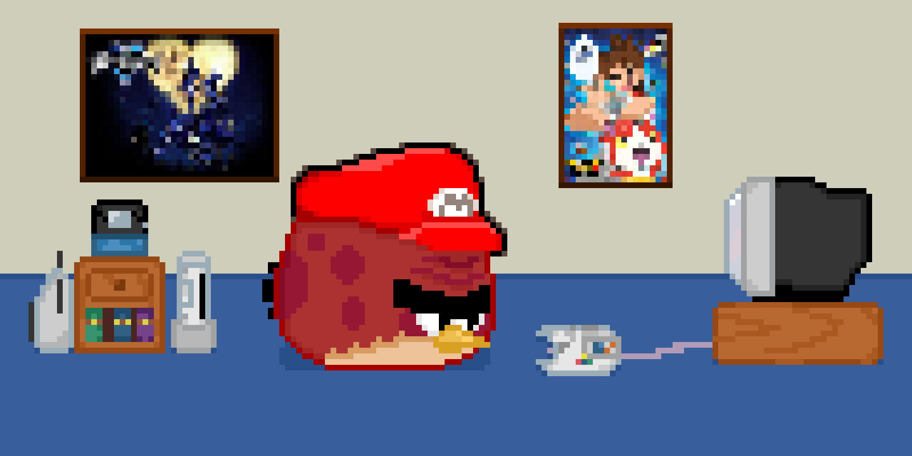

# Bienvenidos a mi perfil de GitHub 🦖🔵

*Although my heart may be weak, it's not alone*\
*It's grown with each new experience,*\
*and it's found a home with all the friends I've made.*\
*I've become a part of their heart just as they've become a part of mine.*\
*And if they think of me now and then...*\
*if they don't forget me... **then our hearts will be one**.*\
*I don't need a weapon. **My friends are my power!***

# Sobre mí 👑♥️

- **Nombre:** Ema
- **Edad:** 19 años
- **Género:** Masculino
- **Carrera:** Ciencia de datos e inteligencia artificial
- **Gustos:** Videojuegos, Anime, Programación, Dibujo, Caminar, Pollos 🐓
- **Disgustos:** Leer, Levantarme temprano, Quedarme mucho tiempo sin hacer nada
- **Facción:** *Bony Spirit hasta la muerte⌚👻*

# Áreas de interés 🎮🥊

El apartado en el que más me siento interesado es en la programación de Videojuegos, si bien todavía me encuentro muy lejos
de programar un juego completo por cuenta propia, es a lo que me quiero dedicar al terminar mi carrera Universitaria.

Es por esto que actualmente me encuentro estudiando Unity durante mis días libres y practicando Pixel Art de vez en cuando si estoy
de humor. No me considero un artista, así que no me suelo sentir con ganas de hacer lo último, pero igual se intenta XD

También me interesa la edición de videos para subir contenido a redes sociales, sin embargo, nunca he contado con el equipo
ni con la motivación para empezar a aprender.

# Habilidades y tecnologías 🖥️🧮

Durante mi vida Universitaria he estudiado y practicado diferentes lenguajes de programación, aunque no me considero un experto
ni domino ninguno, poseo los conocimientos básicos para empezar a estudiarlos por mi cuenta

- Python
- Java
- RStudio
- SQL
- Unity

# Actividad o experiencia

Actualmente no cuento con ninguna experiencia más que proyectos personales incompletos y estudios autónomos, sin embargo, a medida que
mi carrera Universitaria avance y finalmente consiga un trabajo, o complete un proyecto propio, esta sección se irá expandiendo

# Contacto

Me puedes contactar a través de Discord, *casi* siempre suelo responder. Escríbeme si te apasiona Super Smash Bros y
quieres alguien con quien practicar, si quieres hablar sobre algún videojuego o serie, o si te interesa saber más sobre alguno de mis
futuros proyectos.

- [Discord](https://discord.com/users/800142292206747709)

Por aquí también puedes ver mi actividad o agregarme

- [Steam](https://steamcommunity.com/profiles/76561198809736254/)
- [Start.gg](https://www.start.gg/user/a0a6089e)
- [Roblox](https://www.roblox.com/users/381622062/profile)

